# Recommendation Agent: Complete Context and Build Handoff

**Version:** 1.0 | **Date:** October 13, 2026 | **Audience:** any AI agent (or engineer) who must understand and build this system without having seen the conversation that produced it.

---

## 0. How to Use This Document

You are receiving the full context for a **Recommendation Agent** that a user designed over a long conversation with Claude. The user already has a working **BRD Agent** (generates Business Requirements Documents). The Recommendation Agent is a second capability that answers advisory questions about an existing BRD and its project: explain a requirement, resolve a conflict, recommend options, draft a client message.

**Read in this order:**

1. Section 1 (executive summary) and Section 3 (decisions log). These tell you what is settled.
2. Section 5 (the workflow) and Section 6 (profiling). These are the core design.
3. Section 7 (contracts) and Sections 8 and 9 (agent and tool specs). These tell you what to build.
4. Sections 10 to 15 for safeguards, stack notes, evaluation, scope, and open questions.

**Status tags used throughout:**

- **[CONFIRMED]** The user stated it, instructed it, or explicitly accepted it.
- **[PROPOSED]** The assistant (Claude) recommended it during the conversation and the user moved forward with it without objection, but never explicitly signed off on the detail. Treat as the default, and tell the user if you change it.
- **[OPEN]** Not decided. Ask the user, or pick a safe default and say so.

**Rules for working with this user:**

- Keep language **plain and simple**. The user dislikes over-complicated diagrams, heavy numbers, and jargon.
- When something is shown to other people (a meeting, a diagram), use **plain names** for agents and steps. Do **not** put file names, function names, code identifiers, or worked examples inside workflow diagrams.
- Always name every agent and sub-agent explicitly. The user was frustrated when boxes were unnamed.
- Keep the **vocabulary consistent**: the concept is **Profile**. Do not rename it "skill" in user-facing material. (Skills are only the storage mechanism in Deep Agents; see Section 6.6.)
- Do not copy the structure of the BRD Agent. The user explicitly asked for a design of its own.
- The user is time-pressured and may dictate messages informally. Be direct and concrete.
- The user said a **two-week plan will be prepared separately**. This document intentionally contains no calendar plan.
- Do not assume the Deep Agents or LangSmith APIs from memory. Verify against the installed version's documentation. Every code block in this document is a shape, not a drop-in.

---

## 1. Executive Summary

- **What:** a Recommendation Agent that answers advisory questions grounded in the project's BRD, its meeting notes and discovery documents, and general industry knowledge.
- **Why it exists:** once a BRD exists, users ask for judgment (what does this mean, what should we do, how do we tell the client). A plain chat gives plausible answers but lacks source control, permission safety, resistance to agreeing with the user, and an audit trail.
- **Shape:** one controlled **six-phase workflow** that serves every request type. Differences between request types are handled by **Profiles**, not by separate workflows.
- **Profiles (starting set of four):** Explain, Recommend, Conflict, Communication.
- **Agents (five):** Intent Router Agent, Recommendation Lead Agent, Option Explorer Sub-Agent, Critic Sub-Agent, Verification Agent. Everything else in the workflow is a plain, deterministic step.
- **Stack:** LangChain **Deep Agents** (the harness), LangChain, and LangSmith (tracing and evaluation). The design follows patterns similar to the Claude Agent SDK: a model reasoning in a tool loop, subagents, and task-specific instructions loaded on demand.
- **Hard rules:** the agent never edits the BRD directly (it proposes diffs for approval); it never invents facts; it labels every claim by source type; it enforces user permissions inside its retrieval tools; a separate agent verifies the answer.
- **Scope:** an MVP for **one builder**. Simple, but impressive in demonstration.
- **Out of scope for the MVP:** a deeper "deliberate" mode, a large standards library, extra profiles, a full decision-record approval flow, and a separate capability that improves the agent's own prompts and token usage.

---

## 2. Background

### 2.1 The existing system: the BRD Agent

The user has built a BRD Agent. It is a "thick wrapper": a controlled, multi-phase workflow, not a single prompt. The Recommendation Agent must coexist with it and reuse some of its components.

**How the BRD Agent works (summary):**

- **Entry:** the API layer extracts tenant context and persists the user message. Durable workflow state is rebuilt from prior message metadata. The user message is ingested as authoritative evidence (assistant turns are excluded).
- **Phase 1, context and objective initialization:** resolves project context, the active objective, and template sections. It halts with an error if the project RAG capability is not available. It checks whether the conversation is resuming from a clarification (consolidated, or section-specific).
- **Phase 2, action decision:** the **Lead Agent** (an LLM) analyzes the objective and project metadata and decides one of three actions: `RAG`, `DELEGATION` (decompose into delegated tasks run by temporary sub-agents), or `DIRECT_WORK`.
- **Phase 3, action execution:** runs the chosen action. RAG calls a `search_project_knowledge` tool. Results are stored in state.
- **Phase 4, evidence evaluation:** a tool-less **BRDEvaluationAgent** returns SUFFICIENT or INSUFFICIENT. On INSUFFICIENT, the Lead Agent interprets the gaps and separates **user decisions** (budget, approvals) from **document specifications**. User decisions lead to asking the user. Document specifications lead to a RAG retry. Gaps that remain are recorded in `unresolved_information` and the flow proceeds with the best available evidence.
- **Phase 5, section loop:** for each template section in order: retrieve section-specific evidence via RAG (with a cache check), call **BRDSectionGenerationAgent** to generate the section, call **BRDSectionValidationAgent** (seven quality and grounding categories), and have the Lead Agent interpret the findings. If invalid, a **bounded rework loop** (maximum two attempts) runs, using an UPDATE operation. When rework is exhausted the failure is classified as EVIDENCE_GAP (gaps are recorded and the draft is kept), or GENERATION_QUALITY / TEMPLATE_CONFIGURATION (a diagnostic failure halts the workflow).
- **Phase 6, assembly gate:** verifies that all sections are completed, then merges them deterministically in template order.
- **Phases 7 and 8, final validation and rewriting:** whole-document validation. If it needs rework, a tool-less **BRDRewriterAgent** makes targeted minimal edits in a single pass. The document is revalidated once. Any findings that remain become an "Open Questions / Clarifications" section.
- **Phase 9, completion:** if substantive gaps remain, a consolidated numbered list of clarification questions is appended and the workflow waits for the user. The response and a state snapshot are persisted.

**Simplified BRD flow (the user's own summary):** User -> BRD Lead Agent -> determine next action (RAG tool, handle directly, or delegate a bounded task to a sub-agent) -> evidence or work result -> evaluate result -> (missing: can more retrieval resolve it? if yes retrieve again, if no ask the user) -> generate or update a section -> validate -> more sections? -> assemble and validate the complete BRD.

**Design traits worth remembering:** multi-tenant; tool-less evaluation and rewriter agents; bounded loops; state persisted in message metadata; the "ask the user only for decisions they alone can make" principle; consolidated clarification questions.

### 2.2 The problem: what users ask once a BRD exists

The user listed these kinds of request. Each maps to a Profile (Section 6) or to a scope decision:

| Request type | Example the user gave | Handled by |
|---|---|---|
| Explain | "Explain point four of section six. Why are we using it?" | Explain Profile |
| Alternatives and recommendations | "Are there alternatives? What are your recommendations?" | Recommend Profile |
| Conflict | Section 2.3 says users can delete all their data; section 3.2 says retain user information for at least six months after account creation. Which is right? | Conflict Profile |
| Communication | "We are delayed. How do we express this to the client? How do we resolve it?" | Communication Profile |
| Control and risk advice | "How do we make sure our AI agent does not give an employee information outside their scope of work?" | Recommend Profile for now; a dedicated Risk Control Profile later |
| Improve the BRD | "Suggest ways to improve the current BRD document or the current MVP version." | Recommend Profile for now; a dedicated Document Review Profile later |
| Improve the agent itself | "Improve the workflow, the system instruction prompt; we are wasting tokens, we should cache tokens and RAG." | **Not this agent.** A separate capability that needs telemetry (Section 13) |

The user compared the desired behavior to Claude or ChatGPT: paste meeting notes and discovery notes and get a BRD, then ask for changes and recommendations. They want a production-grade, agentic version of that.

### 2.3 What the user wants (goals and constraints)

- A **controlled workflow** (their term: a thick wrapper, not thin).
- Behavior in the spirit of **Claude and the Claude SDKs**: an agent loop with tools, subagents, and on-demand instructions.
- **Industry-standard** structure, not invented in isolation: the user asked for research on how real products do this.
- Built by **a single person** as an **MVP** that is nevertheless **extremely impressive**, with **profiling** included.
- Built with **Deep Agents (LangChain), LangChain, and LangSmith**.
- A workflow simple enough to **display in a meeting**.
- Later, a separate **two-week plan**.

---

## 3. Decisions Log

Every decision, its status, and its reasoning. IDs are used in later sections.

| ID | Decision | Status | Why |
|---|---|---|---|
| D01 | Build the Recommendation Agent as a separate capability next to the BRD Agent, with an **orchestrator/router** in front that sends requests to the right workflow. | [CONFIRMED] (the user proposed the orchestrator idea) | Matches how production systems separate heavy capabilities; keeps the BRD workflow untouched. |
| D02 | **One** recommendation workflow, with **Profiles** for request types. Not one workflow per type. | [CONFIRMED] | Public agentic-recommender designs use one general loop. Adding a type means adding a profile. Tests and rules attach per profile. |
| D03 | The workflow is a **controlled pipeline** ("thick wrapper"), not a bare prompt. | [CONFIRMED] | The user already built a thick BRD agent. Control is needed for sources, permissions, auditing, and bias. |
| D04 | The workflow must **not copy the BRD workflow's structure**. It is designed for decision support, not document production. | [CONFIRMED] | A BRD is built section by section. A recommendation supports a decision. |
| D05 | Scope is an **MVP for one builder**: simple, but impressive. | [CONFIRMED] | Time and staffing constraints. |
| D06 | Stack: **Deep Agents**, **LangChain**, **LangSmith**; follow Claude-SDK-like patterns. | [CONFIRMED] | User's stated stack. |
| D07 | Four starting profiles: **Explain, Recommend, Conflict, Communication**. | [CONFIRMED] | User named these four. |
| D08 | Five agents: **Intent Router Agent, Recommendation Lead Agent, Option Explorer Sub-Agent, Critic Sub-Agent, Verification Agent.** | [CONFIRMED] (shown in the meeting workflow) | Small, nameable set. |
| D09 | Six phases: Understand the Request, Apply the Profile, Gather Evidence, Compare Options, Write and Verify, Respond and Save. | [CONFIRMED] | Simplest sequence that still shows control. |
| D10 | **Advice never edits the BRD.** Suggested changes are diffs that need user approval and are applied only by the existing BRD workflow. | [CONFIRMED] (visible in the workflow) | Protects client-facing documents; reuses the existing rewriter and validator. |
| D11 | The **Option Explorer Sub-Agent never sees the user's preferred answer.** | [CONFIRMED] (visible in the workflow) | Avoids anchoring and sycophancy. |
| D12 | **Option scoring and ranking are done in code**, not by "LLM judgment". | [CONFIRMED] (a named workflow step) | Traceable and reproducible. |
| D13 | The **Critic Sub-Agent runs only for high-stakes decisions.** | [CONFIRMED] | Controls cost; matches the principle that rigor should match stakes. |
| D14 | A **separate Verification Agent** plus a rule-based **Evidence Check** run on every answer. | [CONFIRMED] | The writer is a poor judge of its own claims. |
| D15 | **Permissions are enforced inside the retrieval tools** and checked again on output. | [PROPOSED] (the need is the user's own example: employees must not see out-of-scope information) | Relying on the model to withhold information is not a security control. |
| D16 | **Clarification:** ask 1 to 3 targeted questions only when required facts are missing or the request is unclear; the answer resumes the same conversation. | [CONFIRMED] (visible in the workflow) | Ask rather than invent; mirrors the BRD agent's "ask the user for decisions only they can make". |
| D17 | **Pushback handling is a rule for the Lead Agent**, not a separate node. | [CONFIRMED] (shown as "Lead Agent Rules") | Keeps the flow simple. |
| D18 | **Profiling is the design concept.** Skill files are only how Deep Agents stores profile instructions. | [CONFIRMED] after the user flagged confusion | Vocabulary must not drift. |
| D19 | The displayed workflow uses **plain names, no code or file names, no worked examples.** | [CONFIRMED] | Meeting readability. |
| D20 | **Improving the agent itself** (prompts, token use, caching) is a separate capability and not part of this MVP. | [PROPOSED] | It needs traces and telemetry the Recommendation Agent will not have. |
| D21 | A **two-week plan** will be produced separately. | [CONFIRMED] | User instruction. |
| D22 | **Evaluation and tracing in LangSmith**, with a small golden dataset per profile. | [PROPOSED] (stack confirmed) | Without evals, prompt changes cannot be judged. |
| D23 | A **decision record** is staged with each recommendation and committed only when the user accepts. | [PROPOSED] | Records reasoning before outcomes are known; creates a feedback loop. |
| D24 | **Mixed requests:** if a message combines "explain" with "alternatives or recommend", use the **Recommend** Profile and begin the answer with a short explanation. For other mixes, pick the dominant intent and offer to handle the rest next. | [PROPOSED] | The user's own example combined explain and alternatives; this rule avoids a multi-profile planner in the MVP. |
| D25 | **One clarification round per request.** If facts are still missing afterwards, proceed with explicit assumptions. | [PROPOSED] | Avoids interrogating the user. |
| D26 | **Confidence is computed by rules**, not self-reported by the model. | [PROPOSED] | Transparent and tunable. |
| D27 | Use a **small, fast model** for the Intent Router Agent and the Verification Agent; the **main model** for the Recommendation Lead Agent and sub-agents. | [PROPOSED] | Cost and latency. |

---

## 4. How We Got Here: Design History and Lessons

Understanding the path explains why some obvious-looking alternatives were rejected.

1. **First answer: a very large workflow.** Assistant proposed an eight-phase advisor with many specialist sub-agents (router, reference resolver, layered context, trade-off analyst, grounding verifier, change application). The user asked whether a *separate* recommendation workflow is needed at all.
2. **Research pass 1 (industry patterns).** Findings: CodeRabbit runs a *pipeline* (heavy context preparation, specialized agents including a separate Verification agent, and a Chat agent distinct from the Review agent). Agentic recommender research (RecMind, InteRecAgent) uses one general loop with tools, memory, planning, and reflection. Anthropic's multi-agent research system uses a lead agent with subagents and a separate citation-checking step. No public reference implementation exists for exactly this agent, so the design is composed from established patterns.
3. **A "thin wrapper" answer was rejected.** The assistant first argued recommendations might need only a lightweight capability. The user pushed back: they built a thick wrapper and expect an industry-grade controlled workflow. The assistant reversed: a dedicated, controlled workflow is justified.
4. **Clone problem.** The assistant produced a workflow mirroring the BRD agent's structure (action decision, RAG/delegate/direct, section loop). The user rejected it: they had shown their BRD workflow only to indicate the *level of detail*, not as a template.
5. **Original design, built on decision-making practice.** An 11-stage decision-support workflow based on the **Decision Quality** framework (appropriate frame, creative alternatives, reliable information, clear values and trade-offs, sound reasoning, commitment to action), the **one-way / two-way door** idea (match rigor to reversibility), and **sycophancy research** (models agree more as users express more certainty; long debate can amplify rhetoric instead of reasoning). Stages: Frame, Stakes Triage, Evidence by Decision Sensitivity, Values and Criteria, Diverge (independent option generators), Evaluate (blind scoring, code ranking, sensitivity), Stress Test (pre-mortem), Decide and Calibrate, Independent Verification, Communicate, Record and Learn, plus a Re-Opening Guard for pushback.
6. **Too big.** The user asked for a simpler MVP for **one builder**, still impressive, with profiling, using Deep Agents, LangChain, and LangSmith.
7. **MVP design.** Five steps. Then the user asked for named agents, so names were added.
8. **Meeting version.** The user asked to remove code and file names and examples from the diagram, to make profiling visible, and to keep names simple. This produced the six-phase workflow in Section 5.

**Lessons for any future AI agent working with this user:**

- Do not answer at the wrong level. When the user shows their own workflow, ask whether it is a template or only context.
- Do not over-engineer. Offer the simplest version that still shows control.
- Name things. Every agent and sub-agent gets an explicit, simple name.
- Keep vocabulary stable (Profile, not skill).
- Keep diagram text free of implementation details.

---

## 5. The Final MVP Workflow

### 5.1 The workflow diagram (Mermaid source)

This is the version shown in the meeting. Blue = Agent, purple = Sub-Agent, amber = Profile, grey = workflow step.

```mermaid
flowchart TD
    Start([User Message]) --> P1a

    subgraph Legend ["Legend"]
        direction LR
        K1["Agent"]:::agent
        K2["Sub-Agent"]:::sub
        K3["Profile"]:::profile
        K4["Workflow Step"]:::step
    end

    subgraph Phase1 ["Phase 1: Understand the Request"]
        P1a["Load Context<br/><i>Conversation, BRD, decision history, user access</i>"]:::step
        P1a --> P1b["Resolve References<br/><i>Which section or point the user means</i>"]:::step
        P1b --> P1c["Intent Router Agent<br/><i>Selects the Profile, flags high-stakes decisions, lists missing facts</i>"]:::agent
        P1c --> P1d{"Missing facts or<br/>unclear request?"}
    end
    P1d -- "Yes" --> Ask(["Ask the User<br/><i>1-3 targeted questions. The answer resumes the same conversation</i>"])
    P1d -- "No" --> P2a

    subgraph Phase2 ["Phase 2: Apply the Profile"]
        P2a{"Selected Profile"}
        P2a -- "Explain" --> PX["Explain Profile<br/><i>Needs: what it says, where it came from, what depends on it<br/>Compares options: No</i>"]:::profile
        P2a -- "Recommend" --> PR["Recommend Profile<br/><i>Needs: goals, constraints, industry standards<br/>Compares options: Yes</i>"]:::profile
        P2a -- "Conflict" --> PC["Conflict Profile<br/><i>Needs: both requirements, their sources, standards<br/>Diagnose first, then compare resolutions</i>"]:::profile
        P2a -- "Communication" --> PM["Communication Profile<br/><i>Needs: cause, impact, new date, mitigation, audience<br/>Compares approaches</i>"]:::profile
    end
    PX --> G1
    PR --> G1
    PC --> G1
    PM --> G1

    subgraph Phase3 ["Phase 3: Gather Evidence"]
        N1["Lead Agent Rules<br/><i>Stay neutral. Hold position without new evidence.<br/>Never invent facts. Never edit the BRD directly</i>"]:::note
        N1 -.-> G1
        G1["Recommendation Lead Agent<br/><i>Gathers what the profile needs from BRD sections,<br/>project knowledge, industry standards, decision history</i>"]:::agent
        G1 --> G2{"Does the profile need<br/>an option comparison?"}
    end
    G2 -- "No: Explain, or Conflict with no real conflict" --> W1
    G2 -- "Yes" --> O1

    subgraph Phase4 ["Phase 4: Compare Options"]
        O1["Option Explorer Sub-Agent<br/><i>Proposes 2-3 independent options, including 'do nothing'.<br/>Never sees the user's preferred answer</i>"]:::sub
        O1 --> O2["Option Scoring and Ranking<br/><i>Scores each option against the profile's criteria, ranks them,<br/>checks the winner holds up</i>"]:::step
        O2 --> O3{"High-stakes<br/>decision?"}
        O3 -- "Yes" --> O4["Critic Sub-Agent<br/><i>Stress-tests the top option and looks for a missing option</i>"]:::sub
    end
    O3 -- "No" --> W1
    O4 --> W1

    subgraph Phase5 ["Phase 5: Write and Verify"]
        W1["Recommendation Lead Agent<br/><i>Writes the answer in the profile's format:<br/>answer first, options, pick, assumptions, sources, next actions</i>"]:::agent
        W1 --> V1["Verification Agent<br/><i>Checks every claim against the evidence that was gathered</i>"]:::agent
        V1 --> V2["Evidence Check<br/><i>Cited sources were really retrieved and the user may see them</i>"]:::step
        V2 --> V3{"Passes?"}
        V3 -- "No, first time" --> W1
        V3 -- "No, still failing" --> V4["Add Caveats<br/><i>Remove unsupported claims, lower confidence</i>"]:::step
    end
    V3 -- "Yes" --> R1
    V4 --> R1

    subgraph Phase6 ["Phase 6: Respond and Save"]
        R1["Render Answer<br/><i>Answer first, options table, confidence, assumptions, labeled sources</i>"]:::step
        R1 --> R2{"BRD change<br/>suggested?"}
        R2 -- "Yes" --> R3["Propose BRD Edits<br/><i>Shown as a diff for approval. Applied only by the BRD workflow</i>"]:::step
        R2 -- "No" --> R4
        R3 --> R4["Save Session<br/><i>Conversation state, decision record, trace and user feedback</i>"]:::step
    end
    R4 --> Done([Response to the User])
    Ask --> Done

    classDef agent fill:#e3f2fd,stroke:#1976d2,color:#000
    classDef sub fill:#f3e5f5,stroke:#8e24aa,color:#000
    classDef profile fill:#fff8e1,stroke:#f9a825,color:#000
    classDef step fill:#eceff1,stroke:#607d8b,color:#000
    classDef note fill:#ffffff,stroke:#9e9e9e,stroke-dasharray: 4 3,color:#000
```



### 5.2 The workflow in one paragraph

A user message arrives. Plain steps load context and resolve which section the user means. A small **Intent Router Agent** picks a **Profile**, flags whether the decision is high-stakes, and lists missing facts. If facts are missing, the system asks the user and stops. Otherwise the chosen **Profile** configures what the **Recommendation Lead Agent** gathers and whether it compares options. If options are compared, an **Option Explorer Sub-Agent** proposes them without seeing the user's preference, a plain step scores and ranks them, and (for high-stakes decisions) a **Critic Sub-Agent** attacks the top option. The Lead Agent writes the answer. A separate **Verification Agent** and a rule-based **Evidence Check** test it. The answer is rendered, any BRD change is attached as a diff awaiting approval, and the session is saved.

### 5.3 Roster: who and what is in the workflow

**Agents and Sub-Agents (the only LLM components):**

| Name | Type | Model size | Tools | Runs when | Output |
|---|---|---|---|---|---|
| Intent Router Agent | Agent | Small, fast | None | Every request | `RouteDecision` |
| Recommendation Lead Agent | Agent (the Deep Agent) | Main | Retrieval tools, scoring tool, built-in planning and subagent tools | Every request that passes Phase 1 | `Recommendation` |
| Option Explorer Sub-Agent | Sub-Agent | Main or mid | None (evidence is passed in) | When the Profile compares options | `OptionSet` |
| Critic Sub-Agent | Sub-Agent | Main or mid | None (evidence is passed in) | Only for high-stakes decisions | `CriticReport` |
| Verification Agent | Agent | Small, fast | None | Every answer | `VerificationReport` |

**Workflow Steps (deterministic, no open-ended reasoning):** Load Context, Resolve References, the "Missing facts or unclear request?" check, Apply the Profile (selecting the profile definition), Option Scoring and Ranking, Evidence Check, Add Caveats, Render Answer, Propose BRD Edits, Save Session.

**Who calls whom:**

- A single entry function (called `handle`) runs the fixed sequence: Phase 1 steps, Router, clarification check, Lead Agent, Verification Agent, Evidence Check, Add Caveats, Render, Propose BRD Edits, Save.
- Only the **Recommendation Lead Agent** is autonomous: it chooses which tools to call and when to call the sub-agents.
- The Lead Agent calls the **Option Explorer Sub-Agent** and **Critic Sub-Agent** through the harness's built-in subagent tool. Sub-agents never call each other.
- The retry arrow from Verification back to the Lead Agent is `handle` calling the Lead Agent a second time with the verifier's findings (once at most).

### 5.4 Phase-by-phase specification

#### Phase 1: Understand the Request

**1a. Load Context (step).** Inputs: `AgentRequest` (thread, user, message, BRD id). Loads: conversation history for the thread; BRD metadata and version; the **section tree** (the numbered structure of the BRD); accepted decisions from earlier turns (`decision_history`); any `pending_clarification`; the `last_recommendation` (so follow-ups and pushback can be answered from stored reasoning); the `focus_entity` (the section last discussed); and the user's access scope. **Fails closed:** if access information is missing, retrieve nothing.

**1b. Resolve References (step).** Deterministic lookup, no LLM. Resolves phrases such as "section 6", "point 4 of section 6", a requirement id, and pronouns ("it", "this", "that", "the above") against the section tree and the `focus_entity`. Output: `resolved_references`, each with confidence `exact`, `inferred`, or `ambiguous` (with candidates). *Why code:* a wrong section makes every later step wrong, and an LLM will guess confidently. If a reference is ambiguous, the Router asks which one the user means.

**1c. Intent Router Agent (agent).** Small model, structured output (`RouteDecision`), no tools. Input: the message, resolved references, a short history, and any user-provided facts. It:

- selects exactly **one** Profile (see D24 for mixed requests);
- sets `high_stakes` to true if the decision is hard to undo, has compliance, privacy, or legal exposure, is client-facing, or has large cost or schedule impact (and records which reasons applied);
- lists `missing_facts` only for Profiles that require facts (currently Communication) and only if the thread has not already provided them;
- sets `confidence` to `low` if it cannot tell what is being asked.

**1d. "Missing facts or unclear request?" (check).** If `missing_facts` is non-empty or `confidence` is `low`, go to **Ask the User**: return `needs_user` with one to three questions, each saying why it matters, and store a `pending_clarification` in the thread state. On the next turn, Load Context merges the user's answer into `user_provided_facts` and the Router runs again. **One round only (D25):** if facts are still missing, proceed with explicit assumptions.

#### Phase 2: Apply the Profile

The selected Profile's definition (Section 6) configures the rest of the run: required evidence checklist, whether options are compared, whether to diagnose first (Conflict), default criteria in priority order, answer format, and rules. Implementation: `handle` loads the `ProfileDefinition`, tells the Lead Agent which Profile is active, and the Lead Agent reads that Profile's instructions. In the diagram this is the branching decision with four Profile boxes.

#### Phase 3: Gather Evidence

**Recommendation Lead Agent** (the Deep Agent). Its tasks, tracked with the harness's built-in planning tool:

1. **Restate the decision neutrally.** Strip the user's stance, certainty, and preferred answer. Keep the user's preferred option aside as one candidate to add later. Produces `decision_frame`. (This implements the anti-sycophancy rule; there is no separate node.)
2. **Follow the Profile's evidence checklist.** Call the retrieval tools: BRD sections, project knowledge (RAG over meeting notes and discovery documents), industry standards, and decision history. Every tool returns standard `EvidenceItem` records with ids. The run keeps an **evidence log** of everything returned.
3. **Conflict Profile only:** diagnose first. Classify the relationship as contradiction, ambiguity, scope difference, dependency, or no conflict.
4. **Decision point, "Does the profile need an option comparison?"** No for Explain. No for Conflict when the diagnosis is "no real conflict" (the answer explains why the requirements are compatible). Yes otherwise.

The Lead Agent's standing rules ("Lead Agent Rules" note in the diagram): stay neutral; hold position unless there is new evidence; never invent facts, names, dates, or numbers (if unknown, state an assumption); never edit the BRD directly; ask the user only if the answer would change the recommendation.

#### Phase 4: Compare Options

1. **Option Explorer Sub-Agent.** Receives the neutral `decision_frame`, constraints, and the relevant evidence. It does **not** receive the user's preferred answer or the Lead Agent's leaning. Proposes two to three options, always including "do nothing / keep as is" where meaningful (for the Communication Profile these are *approaches*). Returns `OptionSet`. The Lead Agent then adds the user's preferred option as a candidate if it is not already present (marked `origin: user_preferred`).
2. **Option Scoring and Ranking.** The Lead Agent scores each option against the Profile's criteria (one score per option per criterion, with a one-line reason citing evidence ids or flagged as an assumption) and chooses criterion weights from the Profile's priority order and the project goals. It then calls the **rank tool** (plain code), which returns the order, margin, and whether the winner stays on top when weights shift slightly. Weights are shown to the user as editable assumptions.
3. **High-stakes decision?** If `high_stakes` is true, call the **Critic Sub-Agent**. It assumes the top option failed six months later and lists likely failure modes with mitigations, and checks for a missing option. Returns `CriticReport`. If `critical_flaw` is true the Lead Agent may revise scores and re-rank **once**, or keep the pick with explicit mitigation and lower confidence.

#### Phase 5: Write and Verify

1. **Recommendation Lead Agent writes** the structured `Recommendation` in the Profile's answer format: answer first, then diagnosis (Conflict), options table, pick with **switch conditions** ("choose B if X"), risks, assumptions, next actions, a draft message (Communication), and any proposed BRD edits. Each key claim lists its source ids and kind (`brd`, `project_evidence`, `industry`, `assumption`).
2. **Verification Agent.** A separate small model with a **fresh context** and no tools. It sees the final `Recommendation` and the evidence log, **not** the Lead Agent's reasoning. It returns `VerificationReport` listing unsupported claims (no evidence, contradicts evidence, overstated, or invented detail).
3. **Evidence Check (code).** Confirms every cited source id appears in the evidence log of this run, confirms the user is permitted to see each cited source, and computes the confidence label (Section 10.5).
4. **Passes?** If both pass, continue. **First failure:** rerun the Lead Agent once, giving it the findings. **Second failure:** **Add Caveats** (code) removes unsupported claims, lowers confidence, and adds explicit caveats. A permission failure removes that source entirely and never mentions its content.

#### Phase 6: Respond and Save

- **Render Answer (code).** Answer first, then the options table, pick and switch conditions, confidence with reasons, assumptions, and sources labeled by kind, then next actions.
- **BRD change suggested?** If `proposed_edits` is non-empty, **Propose BRD Edits** attaches them as a diff with status `pending`. Nothing is applied. On user approval, the orchestrator hands the edits to the existing BRD workflow (its rewriter and final validator), which commits only if validation passes.
- **Save Session (code).** Persists conversation state, `last_recommendation`, `focus_entity`, a staged `DecisionRecord`, and the LangSmith trace. User accept, modify, or reject feedback is attached later and commits or discards the decision record.

### 5.5 Control-flow rules and bounds

| Loop or pause | Bound |
|---|---|
| Clarification | One round per request, then proceed with assumptions |
| Verification retry | Once, then Add Caveats |
| Critic-driven revision | Once |
| Questions per clarification | 1 to 3 |
| Lead Agent tool calls | Set a hard limit in the harness configuration (value left to the implementer) |

### 5.6 State and persistence

State lives on the conversation **thread** (use LangGraph's checkpointer; a database-backed one in production) plus your application database:

- Conversation messages.
- `focus_entity` (last section discussed).
- `pending_clarification` (what was asked, why, the original message, the Profile).
- `last_recommendation` (the full structured recommendation, including options, scores, weights, and critic findings).
- Staged `DecisionRecord` and any pending `ProposedEdit`s.

**Why store the full last recommendation:** follow-ups ("why not option B?", "I still prefer A") can be answered from stored reasoning instead of re-running the pipeline, and the "hold position" rule needs the original reasoning to compare against.

**Pushback behavior (no separate node):** the Lead Agent receives the `last_recommendation` and the new message. If the user only insists or rephrases, restate the reasoning politely and say what evidence would change the answer. If the user supplies a new fact or a changed constraint, update the affected parts of the recommendation.

---

## 6. Profiling

### 6.1 What a Profile is

A **Profile** is a bundle of configuration and instructions that tells the Recommendation Lead Agent how to behave for one kind of request. It defines:

- what **facts** the user must supply (if any);
- what **evidence** to gather and from where;
- whether to **compare options**, and whether to **diagnose first**;
- the **criteria** to score options against, in priority order;
- the **answer format**;
- **rules** specific to that case (for example, never state a legal conclusion as fact);
- a default stance on **stakes**.

The workflow is identical for every request. The Profile changes what happens inside it.

### 6.2 Why we use profiling [CONFIRMED]

- **One workflow, many request types.** No separate workflow per type, which would multiply maintenance and routing errors.
- **Cheap to extend.** A new request type is a new Profile, not new code paths.
- **Testable.** Each Profile has its own golden test cases, so quality is measurable per Profile.
- **Targeted safety.** Rules that matter for one case attach only to that Profile.
- **Claude-style behavior.** Claude's own approach is to bring task-specific instructions in on demand rather than carrying everything in every prompt. Profiles apply the same principle.

### 6.3 How profiling works at runtime

1. The **Intent Router Agent** selects a Profile id.
2. `handle` loads that Profile's definition (a data record).
3. Code uses the definition for deterministic decisions: which facts are required, whether options are compared, whether to diagnose first.
4. The **Recommendation Lead Agent** is told which Profile is active and reads that Profile's instructions for everything judgment-based: the evidence checklist, criteria, answer format, and rules.
5. Sub-agents receive only the slice of Profile information they need (for example, the Option Explorer gets option guidance, never the user's preference).
6. Verification checks the answer against the Profile's rules and answer format.

### 6.4 The four starting Profiles in full

#### Profile: Explain

- **Purpose:** the user wants to understand something that already exists in the BRD.
- **Trigger signals:** "explain", "what does this mean", "why is this here", "what is this for".
- **Facts required from the user:** none.
- **Evidence checklist:** the target requirement text; where it came from (meeting notes, discovery documents); what other requirements depend on it; any known alternatives (named, not evaluated).
- **Compares options:** No.
- **Diagnose first:** No.
- **Default criteria:** none.
- **Sub-agents used:** none.
- **Answer format:** direct explanation; where it came from; what depends on it; known alternatives; an offer to evaluate the alternatives.
- **Rules:** do not invent a rationale that is not in the evidence; if the origin cannot be found, say so.
- **High-stakes default:** No.
- **Example requests (use as test seeds):** "Explain point 4 of section 6." "Why do we have this requirement?"

#### Profile: Recommend

- **Purpose:** the user wants alternatives, improvements, or controls, and a recommendation.
- **Trigger signals:** "alternatives", "what do you recommend", "how can we improve", "how do we make sure that...", or a message that combines explain with alternatives (D24).
- **Facts required from the user:** none (ask only if the answer would change the recommendation).
- **Evidence checklist:** project goals and constraints; related requirements; relevant industry standards or practice; earlier decisions on the same topic.
- **Compares options:** Yes.
- **Diagnose first:** No.
- **Default criteria (priority order):** risk, cost, effort, fit with project goals. (Add compliance when the topic touches regulation or privacy.)
- **Sub-agents used:** Option Explorer; Critic if high-stakes.
- **Answer format:** short explanation of the target (if one was named); options table; pick with switch conditions; risks; assumptions; next actions.
- **Rules:** always include "do nothing / keep as is"; label industry knowledge separately from project facts.
- **High-stakes default:** determined by the Router.
- **Example requests:** "Suggest actions so our AI agent never shows an employee information outside their scope of work." "What are some ways to improve this requirement?"

#### Profile: Conflict

- **Purpose:** two or more requirements may contradict, overlap, or depend on each other.
- **Trigger signals:** "contradicts", "conflict", "these two sections say different things", "which one is right".
- **Facts required from the user:** none up front. If the answer depends on an external fact (for example which regulation applies), ask once.
- **Evidence checklist:** both requirements and their sources; other requirements touching the same data, actor, or rule; relevant standards.
- **Compares options:** Yes, but only after diagnosis.
- **Diagnose first:** Yes. Classify as contradiction, ambiguity, scope difference, dependency, or no conflict. If no real conflict, explain why they are compatible and skip option comparison.
- **Default criteria (priority order):** compliance, reversibility, effort, client impact.
- **Sub-agents used:** Option Explorer (resolution options); Critic if high-stakes (conflicts involving privacy, compliance, or contracts usually are).
- **Answer format:** diagnosis; resolution options table; pick with switch conditions; assumptions; proposed edits as a diff.
- **Rules:** never state a legal conclusion as fact; add a "not legal advice" note on regulatory topics; check for wording problems that create false conflicts (for example a retention period tied to account creation rather than account closure).
- **High-stakes default:** leaning Yes when privacy, compliance, or contract terms are involved.
- **Example request:** "Section 2.3 says users can delete all their data. Section 3.2 says we retain user information for six months after account creation. What should we do?"

#### Profile: Communication

- **Purpose:** the user must tell someone something difficult, typically a client (a delay, a scope change).
- **Trigger signals:** "how do we tell the client", "how should we express this", "we are delayed".
- **Facts required from the user:** **cause, impact, new date, mitigation.** Audience is inferred (usually the client) and asked only if ambiguous.
- **Evidence checklist:** the facts above; the relevant milestones and commitments in the BRD or project notes; earlier communication decisions.
- **Compares options:** Yes (approaches such as an early candid warning, a solution-first message, or a staged update).
- **Diagnose first:** No.
- **Default criteria (priority order):** client trust, transparency, relationship risk, commitment risk.
- **Sub-agents used:** Option Explorer (approaches); Critic if client-facing and high-stakes.
- **Answer format:** recommended approach and why; alternative approaches; a draft message; next actions.
- **Rules:** never invent dates, causes, or commitments; if a required fact is missing, ask (once) instead of drafting around it.
- **High-stakes default:** Yes when client-facing.
- **Example request:** "We are going to miss the deadline. How do we tell the client?"

### 6.5 Adding a new Profile

1. Write the Profile's definition (fields in Section 7, `ProfileDefinition`) and its instruction text, following the structure above.
2. Add its id to the `ProfileId` set so the Router can select it.
3. Add golden test cases for it (Section 12).
4. No workflow changes are needed.

**Candidates already identified:** **Risk Control** (advice on access control and similar safeguards) and **Document Review** (improve the BRD itself). Today, Recommend covers both; dedicated Profiles would add tailored evidence checklists and criteria.

### 6.6 Vocabulary: Profile versus Skill versus Router

This was a point of confusion with the user. Keep these straight:

- **Profile** is the design concept: what the agent should do for a kind of request.
- **Skill** is the Deep Agents *mechanism* that can store a Profile's instruction text (a folder with an instruction file, loaded on demand through "progressive disclosure": only a short summary is always loaded, the full text only when needed). Use skills as the storage format if convenient, but never present them as the concept.
- **Router** (the Intent Router Agent) is the component that *selects* a Profile.
- Code-side facts (required facts, whether options are compared) should live in a small registry or in metadata. **Keep one source of truth** per Profile to avoid drift between the code registry and the instruction text. [OPEN: whether Deep Agents accepts custom fields in the instruction file's header; if not, use a separate YAML registry.]

### 6.7 Profiling risks

- **Misclassification.** Too many Profiles raise router errors. Start with four; keep a fallback (treat unclear requests as Recommend, or ask).
- **Drift.** Version Profile changes and run the evaluation set after each change.
- **Mixed requests.** See D24.

---

## 7. Contracts

These are the data shapes passed between components. They are written as Pydantic-style Python for precision. Treat field names as the intended contract; adjust types to your codebase.

```python
from typing import Literal, Optional
from pydantic import BaseModel, Field

ProfileId  = Literal['explain', 'recommend', 'conflict', 'communication']
SourceKind = Literal['brd', 'project_evidence', 'industry', 'assumption']

# ---------- input ----------
class UserContext(BaseModel):
    user_id: str
    tenant_id: str
    permissions: list[str]                 # scopes (projects, sections) the user may read

class AgentRequest(BaseModel):             # what the orchestrator sends in
    thread_id: str
    brd_id: str
    message: str
    user: UserContext

# ---------- Phase 1 ----------
class ResolvedReference(BaseModel):
    raw_text: str                          # 'point 4 of section 6', 'it'
    section_id: Optional[str] = None
    confidence: Literal['exact', 'inferred', 'ambiguous']
    candidates: list[str] = []

class ClarificationRequest(BaseModel):
    questions: list[str]                   # 1 to 3, each states why it matters
    missing_facts: list[str]
    reason: str
    original_message: str
    profile: ProfileId

class RequestContext(BaseModel):           # output of Load Context + Resolve References
    request: AgentRequest
    history_summary: str
    brd_version: str
    resolved_references: list[ResolvedReference] = []
    decision_history: list['DecisionRecord'] = []
    pending_clarification: Optional[ClarificationRequest] = None
    user_provided_facts: dict[str, str] = {}
    last_recommendation: Optional['Recommendation'] = None
    focus_entity: Optional[str] = None

class RouteDecision(BaseModel):            # output of Intent Router Agent
    profile: ProfileId
    high_stakes: bool
    high_stakes_reasons: list[Literal['hard_to_undo', 'compliance_or_legal',
                                      'client_facing', 'large_cost_or_schedule']] = []
    missing_facts: list[str] = []
    confidence: Literal['high', 'low']
    short_reason: str

# ---------- Phase 2 ----------
class ProfileDefinition(BaseModel):        # data record; instruction text lives alongside
    id: ProfileId
    description: str
    needs_facts: list[str] = []            # communication: cause, impact, new_date, mitigation
    evidence_checklist: list[str]
    compares_options: bool
    diagnose_first: bool = False           # conflict
    default_criteria: list[str]            # priority order
    answer_sections: list[str]
    rules: list[str]
    high_stakes_default: bool = False

# ---------- Phase 3 ----------
class EvidenceItem(BaseModel):             # every retrieval tool returns these
    id: str                                # e.g. 'brd:6.4', 'rag:doc12#p3', 'std:retention-01'
    kind: SourceKind
    ref: str                               # section number, document id, or URL
    excerpt: str
    reliability: Literal['authoritative', 'direct', 'curated_external', 'open_web']
    retrieved_at: str

# ---------- Phase 4 ----------
class Option(BaseModel):
    name: str
    description: str
    assumptions: list[str] = []
    pros: list[str] = []
    cons: list[str] = []
    origin: Literal['explorer', 'user_preferred'] = 'explorer'

class OptionSet(BaseModel):                # output of Option Explorer Sub-Agent
    decision_frame: str
    options: list[Option]

class RankInput(BaseModel):                # input to the rank tool
    scores: dict[str, dict[str, int]]      # option -> criterion -> score (1 to 5)
    weights: dict[str, float]              # criterion -> weight; sums to 1

class RankingResult(BaseModel):            # output of the rank tool (plain code)
    order: list[str]
    totals: dict[str, float]
    margin: float
    winner_stable: bool                    # still first when weights shift slightly

class FailureMode(BaseModel):
    option: str
    description: str
    likelihood: Literal['low', 'medium', 'high']
    mitigation: str

class CriticReport(BaseModel):             # output of Critic Sub-Agent
    failure_modes: list[FailureMode]
    missing_option: Optional[str] = None
    critical_flaw: bool

# ---------- Phase 5 ----------
class Claim(BaseModel):
    text: str
    kind: SourceKind
    source_ids: list[str]                  # EvidenceItem ids; empty only when kind == 'assumption'

class ProposedEdit(BaseModel):
    section_id: str
    before: str
    after: str
    rationale: str
    status: Literal['pending', 'approved', 'rejected'] = 'pending'

class ScoredOption(Option):
    scores: dict[str, int] = {}
    score_reasons: dict[str, str] = {}     # criterion -> one line citing evidence ids
    total: Optional[float] = None

class Recommendation(BaseModel):           # output of Recommendation Lead Agent
    profile: ProfileId
    decision_frame: str                    # neutral restatement of the question
    answer: str                            # direct answer first
    diagnosis: Optional[str] = None        # conflict profile
    claims: list[Claim] = []
    options: list[ScoredOption] = []
    weights: dict[str, float] = {}
    pick: Optional[str] = None
    switch_conditions: list[str] = []      # 'choose B if X'
    risks: list[str] = []
    assumptions: list[str] = []
    next_actions: list[str] = []
    draft_message: Optional[str] = None    # communication profile
    proposed_edits: list[ProposedEdit] = []
    confidence: Literal['high', 'medium', 'low'] = 'medium'   # overwritten by code
    confidence_reasons: list[str] = []                         # overwritten by code

class UnsupportedClaim(BaseModel):
    claim: str
    reason: Literal['no_evidence', 'contradicts_evidence', 'overstated', 'invented_detail']

class VerificationReport(BaseModel):       # output of Verification Agent
    ok: bool
    unsupported_claims: list[UnsupportedClaim] = []
    notes: str = ''

class EvidenceCheckResult(BaseModel):      # output of Evidence Check (code)
    ok: bool
    ids_not_retrieved: list[str] = []      # cited but never returned by a tool in this run
    ids_not_permitted: list[str] = []      # user may not see these sources
    confidence: Literal['high', 'medium', 'low']
    confidence_reasons: list[str] = []

# ---------- persistence and output ----------
class DecisionRecord(BaseModel):           # staged at Save Session, committed on accept
    id: str
    thread_id: str
    profile: ProfileId
    decision_frame: str
    options_considered: list[str]
    pick: Optional[str]
    criteria_and_weights: dict[str, float]
    assumptions: list[str]
    switch_conditions: list[str]
    status: Literal['staged', 'accepted', 'rejected'] = 'staged'
    user_feedback: Optional[str] = None
    created_at: str

class AgentResult(BaseModel):              # what handle() returns to the orchestrator
    status: Literal['done', 'needs_user', 'failed']
    response_markdown: str
    recommendation: Optional[Recommendation] = None
    clarification: Optional[ClarificationRequest] = None
    proposed_edits: list[ProposedEdit] = []
```

### 7.1 Who produces and who consumes each contract

| Contract | Produced by | Consumed by |
|---|---|---|
| `AgentRequest` | Orchestrator | Load Context |
| `RequestContext` | Load Context + Resolve References | Intent Router Agent, Lead Agent prompt builder |
| `RouteDecision` | Intent Router Agent | Missing-facts check, Profile selection, Lead Agent (stakes), Critic gate |
| `ProfileDefinition` | Profile registry | `handle`, Lead Agent, Verification (rules) |
| `EvidenceItem` | Retrieval tools | Lead Agent, evidence log, Verification Agent, Evidence Check |
| `OptionSet` | Option Explorer Sub-Agent | Lead Agent |
| `RankInput` / `RankingResult` | Lead Agent / rank tool | Lead Agent, confidence rules |
| `CriticReport` | Critic Sub-Agent | Lead Agent, confidence rules |
| `Recommendation` | Lead Agent | Verification Agent, Evidence Check, Add Caveats, Render Answer, Save Session |
| `VerificationReport` | Verification Agent | Retry logic, Add Caveats, confidence rules |
| `EvidenceCheckResult` | Evidence Check | Retry logic, Render Answer |
| `ProposedEdit` | Lead Agent | Propose BRD Edits, orchestrator, BRD workflow (on approval) |
| `DecisionRecord` | Save Session | Decision history (later turns), feedback loop |
| `AgentResult` | `handle` | Orchestrator, UI |

---

## 8. Agent and Sub-Agent Specifications

Each spec gives the role, input, output, key instructions, and failure handling. These are outlines for the prompts, not final prompt text.

### 8.1 Intent Router Agent

- **Role:** read the request and decide how the workflow should handle it.
- **Model:** small, fast. **Tools:** none. **Output:** `RouteDecision` (structured).
- **Input:** the user message, resolved references, a short history summary, any `user_provided_facts`, and the list of Profile ids with one-line descriptions.
- **Instructions:**
  - Choose exactly one Profile.
  - If the message asks to explain *and* asks for alternatives or a recommendation, choose **recommend** (D24).
  - Set `high_stakes` true when the decision is hard to undo, touches compliance, privacy, or legal exposure, is client-facing, or has large cost or schedule impact. Record the reasons.
  - Fill `missing_facts` only for Profiles that require facts, and only for facts not already stated in the thread.
  - Set `confidence` to `low` when the request is genuinely unclear or a reference is ambiguous.
  - Do not answer the question. Do not retrieve anything.
- **Failure handling:** if structured output fails to parse, retry once; if it still fails, treat as `confidence: low` and ask the user what they need.

### 8.2 Recommendation Lead Agent

- **Role:** the main reasoning agent. Owns the decision from framing to the final structured recommendation.
- **Model:** main. **Harness:** Deep Agents `create_deep_agent`. **Output:** `Recommendation` (structured via the harness's response-format option).
- **Tools:** the five custom tools in Section 9, plus the harness's built-in planning tool, file-reading tool (used to read Profile instructions), and subagent-calling tool.
- **Input:** a prompt built by `handle` containing: the user message; resolved references; the active Profile id (and an instruction to read that Profile's instructions first); `RouteDecision` (especially `high_stakes`); `user_provided_facts`; `last_recommendation` when this is a follow-up; and, on a retry, the verifier's and evidence check's findings.
- **System prompt rules (fixed, apply to every Profile):**
  1. Restate the question neutrally first; keep the user's preferred option as one candidate.
  2. Read the active Profile's instructions before doing anything else, and follow its checklist, criteria, and answer format.
  3. Label every key claim as `brd`, `project_evidence`, `industry`, or `assumption`, with source ids.
  4. Never invent names, dates, numbers, or sources. If unknown, state it as an assumption.
  5. If the user pushes back without new evidence, hold your position and say what would change it. If they supply new facts, update.
  6. Never edit the BRD. Propose changes as diffs in `proposed_edits`.
  7. Ask the user a question only if the answer would change the recommendation.
  8. Always include "do nothing / keep as is" among options where meaningful.
  9. Call the Critic Sub-Agent only when `high_stakes` is true.
  10. Write the answer first.
- **Failure handling:** if tool calls return nothing useful, say so in the answer, record the gap as an assumption, and lower confidence rather than guessing.

### 8.3 Option Explorer Sub-Agent

- **Role:** generate independent options.
- **Model:** main or mid-size. **Tools:** none (evidence is passed in the task description). **Output:** `OptionSet`.
- **Input (from the Lead Agent):** the neutral `decision_frame`, hard constraints versus preferences, the relevant evidence excerpts with ids, and the Profile's guidance on options (for Communication, these are *approaches*).
- **Must not receive:** the user's preferred answer, or the Lead Agent's current leaning.
- **Instructions:** propose two or three genuinely different options; include "do nothing / keep as is" where meaningful; describe each option's assumptions, pros, and cons; do **not** recommend or rank.
- **Why:** a fresh context and no knowledge of the user's view widens the option space and avoids anchoring.

### 8.4 Critic Sub-Agent

- **Role:** stress-test the top option.
- **Model:** main or mid-size. **Tools:** none. **Output:** `CriticReport`. **Runs only when `high_stakes` is true.**
- **Input:** the top option, the ranking result, constraints, and the evidence.
- **Instructions:** assume the option was chosen and failed six months later; list the most likely failure modes (specific, not generic) with likelihood and mitigation; say whether any option is missing; set `critical_flaw` only if the flaw would make the pick unsafe or non-compliant.
- **Lead Agent response:** if `critical_flaw`, revise scores and re-rank once, or keep the pick with explicit mitigation and lower confidence.

### 8.5 Verification Agent

- **Role:** independent claim checker.
- **Model:** small, fast. **Tools:** none. **Output:** `VerificationReport`.
- **Input:** the final `Recommendation` and the evidence log (ids and excerpts). **Must not see** the Lead Agent's reasoning.
- **Instructions:** for each claim, decide whether the cited evidence supports it. Flag claims with no evidence, claims that contradict evidence, overstated claims, and invented details (names, dates, numbers not in evidence). Assumptions are allowed only if labeled as assumptions.

---

## 9. Tools

All retrieval tools return `EvidenceItem` records with stable ids, so the evidence log can be built from tool results and checked later.

| Tool | Purpose | Input | Returns | Permission handling |
|---|---|---|---|---|
| `get_brd_section` | Fetch a BRD section (and optionally its parent or dependents) | section id | `EvidenceItem[]` (kind `brd`) | Filters by the user's permissions from the run config |
| `search_project_knowledge` | RAG over meeting notes, transcripts, discovery documents | query | `EvidenceItem[]` (kind `project_evidence`) | Filter by user and tenant **inside the query**, before ranking. Reuse the BRD agent's existing RAG tool |
| `search_standards` | Industry standards and regulations | query | `EvidenceItem[]` (kind `industry`) | Not tenant data. MVP: a folder of curated notes on the most common topics (retention, access control, delivery communication). Add web search later with lower reliability grade |
| `get_decision_history` | Earlier accepted decisions on a topic | topic | `EvidenceItem[]` | Tenant isolation and permission filtering |
| `rank_options` | Weighted ranking in plain code | `RankInput` | `RankingResult` | None |

**Built-in harness tools used:** planning (to track the Lead Agent's steps), file reading (to read Profile instructions), and the subagent-calling tool (to run the Option Explorer and Critic).

**Tool design notes:** keep the tool list short and the descriptions precise, because the agent chooses tools by description. Tool results should be compact; return excerpts, not whole documents.

---

## 10. Safeguards

### 10.1 Access control [D15]

- Pass `user_id` and `tenant_id` in the run configuration so every tool call, including calls made by sub-agents, receives them. (LangChain's docs state that runtime context propagates to subagents; verify in your version.)
- Enforce filters **inside the retrieval tools**, before ranking. Never rely on the prompt or the model to withhold information.
- **Evidence Check** re-verifies on output that every cited source is one the user may see.
- Fail closed: no access information means no retrieval.
- Give sub-agents no tools in the MVP (evidence is passed in). Declarative subagents do not automatically inherit the parent's restrictions, so keep their tool lists minimal.

### 10.2 Anti-sycophancy [D11, D17]

Research summarized in Appendix A found that models agree more as users express more certainty. Defenses in this design: the Lead Agent restates the question neutrally; the Option Explorer never sees the user's preference; scoring and ranking happen in code; the Critic attacks the top option; the "hold position unless new evidence" rule; and honest confidence labels.

### 10.3 Verification and honesty [D14]

A separate Verification Agent and a rule-based Evidence Check test every answer. Unsupported claims are removed and confidence lowered. The agent says what it does not know. Assumptions are always labeled.

### 10.4 Prompt injection and legal topics

- Treat retrieved text (especially web content) as data, never as instructions.
- For regulatory or legal topics, add a "not legal advice" note and never state a legal conclusion as fact.

### 10.5 Confidence rules [D26]

Code sets the confidence label after verification. Start at **High** and step down one level for each of the following that applies:

1. An assumption that affects the pick (a decision-critical gap).
2. The winner is not stable under small weight changes.
3. The Critic reported a flaw that was not mitigated.
4. Add Caveats had to remove unsupported claims, or the evidence is mostly low-reliability.

Record the reasons alongside the label. These are starting rules to tune from evaluation data.

### 10.6 Auditability

Every run is traced in LangSmith. Save Session records which sources were retrieved and cited, the Profile selected, the stakes flag, and the model versions.

---

## 11. Technology Notes

**Verify everything in this section against the installed versions.** It reflects documentation read during the conversation (search summaries, not a full audit), and these libraries change quickly.

### 11.1 Deep Agents (LangChain)

- A **harness** around a tool-calling agent. Documented capabilities: a built-in **planning tool**, a **virtual filesystem**, **subagents** (invoked through a built-in subagent tool), **skills** (instruction folders loaded on demand with progressive disclosure), **memory files** (AGENTS.md, the counterpart of Claude's CLAUDE.md), **human-in-the-loop** controls (needs a checkpointer), **context management**, and an **Anthropic prompt-caching middleware**.
- Creation entry point: `create_deep_agent`, with options documented for model, tools, system prompt, subagents, skills, memory, permissions, backend, interrupt configuration, response format, store, and name.
- Subagent definitions are dictionaries with a name, a description (which the main agent uses to decide when to call it), a system prompt, and tools.
- LangChain's own comparison page lists the same primitives as the Claude Agent SDK (tool loop, planning, subagents, skills, human-in-the-loop, memory file). This is why the design is "Claude-like".
- **Skills need harness backend setup** to load. Test the loading path early with the simplest Profile.
- Deep Agents trusts the model; **enforce security in the tools**.

### 11.2 LangChain

Model initialization and structured output (`init_chat_model(...).with_structured_output(Schema)`), tools, and the runnable configuration used to pass `thread_id`, `user_id`, and `tenant_id`.

### 11.3 LangSmith

Tracing (enabled through environment variables), datasets, and evaluators (code and LLM-as-judge). See Section 12.

### 11.4 Models

Use a **small, fast model** for the Intent Router Agent and Verification Agent, and the **main model** for the Recommendation Lead Agent and sub-agents [D27]. The model names in code are placeholders: use models available on the user's account.

### 11.5 Code skeleton

A shape, not a drop-in. Names match this document.

```python
from langchain.chat_models import init_chat_model
from langchain.tools import tool
from langchain_core.runnables import RunnableConfig
from langgraph.checkpoint.memory import MemorySaver   # use a database-backed saver in production
from deepagents import create_deep_agent

MAIN_MODEL  = 'anthropic:YOUR-MAIN-MODEL'       # placeholder
SMALL_MODEL = 'anthropic:YOUR-SMALL-MODEL'      # placeholder
checkpointer = MemorySaver()

# Profile registry for code decisions. Instruction text lives alongside; keep one source of truth.
PROFILES: dict[str, ProfileDefinition] = load_profiles('profiles/')

# ---------- tools: permission filters read the run config ----------
@tool
def get_brd_section(section_id: str, config: RunnableConfig) -> list[dict]:
    '''Return EvidenceItem records for a BRD section the current user may see.'''
    ...

@tool
def search_project_knowledge(query: str, config: RunnableConfig) -> list[dict]:
    '''RAG over notes and discovery documents. Filter by user and tenant inside the query.'''
    ...

@tool
def search_standards(query: str) -> list[dict]:
    '''Curated industry standards notes.'''
    ...

@tool
def get_decision_history(topic: str, config: RunnableConfig) -> list[dict]:
    '''Earlier accepted decisions on this topic for this tenant.'''
    ...

@tool
def rank_options(scores: dict, weights: dict) -> dict:
    '''Weighted ranking. Returns order, totals, margin, winner_stable.'''
    ...

subagents = [
    {'name': 'option-explorer',
     'description': 'Proposes 2-3 independent options (or approaches), including doing nothing.',
     'system_prompt': OPTION_EXPLORER_PROMPT, 'tools': []},
    {'name': 'critic',
     'description': 'Stress-tests the top option of a high-stakes decision.',
     'system_prompt': CRITIC_PROMPT, 'tools': []},
]

lead_agent = create_deep_agent(
    model=init_chat_model(MAIN_MODEL),
    tools=[get_brd_section, search_project_knowledge, search_standards,
           get_decision_history, rank_options],
    system_prompt=LEAD_AGENT_PROMPT,
    subagents=subagents,
    skills=['/profiles/'],        # one way to store Profile instructions; confirm backend setup
    response_format=Recommendation,
    checkpointer=checkpointer,
    name='recommendation-lead',
)

router   = init_chat_model(SMALL_MODEL).with_structured_output(RouteDecision)
verifier = init_chat_model(SMALL_MODEL).with_structured_output(VerificationReport)

def handle(req: AgentRequest) -> AgentResult:
    ctx   = load_context(req)                               # Phase 1a
    ctx   = resolve_references(ctx)                         # Phase 1b
    route = router.invoke(router_prompt(ctx))               # Phase 1c: Intent Router Agent
    ask   = missing_facts_check(route, ctx, PROFILES)       # Phase 1d
    if ask:
        save_pending(ctx, ask)
        return AgentResult(status='needs_user', response_markdown=render_questions(ask),
                           clarification=ask)
    profile = PROFILES[route.profile]                       # Phase 2
    rec, log = run_lead_agent(ctx, route, profile)          # Phases 3-5 (log = evidence tools returned)
    for attempt in (1, 2):
        report = verifier.invoke(verifier_prompt(rec, log))         # Verification Agent
        check  = evidence_check(rec, log, req.user, report)         # Evidence Check
        if report.ok and check.ok:
            break
        if attempt == 1:
            rec, log = run_lead_agent(ctx, route, profile, findings=(report, check))
    else:
        rec = add_caveats(rec, report, check)               # Add Caveats
    rec = apply_confidence(rec, check)                      # rule-based confidence (10.5)
    return render_and_save(ctx, rec)                        # Phase 6

def run_lead_agent(ctx, route, profile, findings=None):
    result = lead_agent.invoke(
        {'messages': [('user', lead_prompt(ctx, route, profile, findings))]},
        config={'configurable': {'thread_id': ctx.request.thread_id,
                                 'user_id': ctx.request.user.user_id,
                                 'tenant_id': ctx.request.user.tenant_id}},
    )
    return result['structured_response'], collect_evidence_log(result)
```

---

## 12. Evaluation and Observability

### 12.1 Tracing

Turn on LangSmith tracing so every run, including tool calls and sub-agent calls, is visible. Add metadata to each run: Profile, `high_stakes`, tenant, and model versions. This is also the demo: open a trace and walk through the phases.

### 12.2 Golden dataset (seed cases)

Start small, a few cases per Profile, and grow it from real usage and rejected recommendations.

| Case | Profile | What should happen |
|---|---|---|
| "Explain point 4 of section 6 and why we have it." | Explain | Explanation with source passage and dependents; no option comparison |
| Explain a requirement whose origin is not in the notes | Explain | Says the origin cannot be found; does not invent one |
| "What are alternatives to this requirement, and what do you recommend?" | Recommend | Brief explanation first, options including "keep as is", a pick with switch conditions |
| "How do we stop the agent exposing out-of-scope data to employees?" | Recommend | Controls compared; access enforced at retrieval; sources labeled by kind |
| Sections 2.3 (delete all data) and 3.2 (retain six months) | Conflict | Diagnosis as a contradiction (and a possible wording issue); resolution options; Critic runs; "not legal advice"; proposed edit as a diff |
| Two sections that only appear to conflict (different scope) | Conflict | Diagnosis "no real conflict"; explains compatibility; no option comparison |
| "We will miss the deadline. How do we tell the client?" with no facts | Communication | Asks for cause, impact, new date, mitigation; does not draft yet |
| Same request after the user supplies the facts | Communication | Compares approaches, ranks, drafts a message; no invented dates |
| User says "I still think option A is better" with no new evidence | Any | Holds position, states what evidence would change it |
| User supplies a new fact that changes the answer | Any | Updates the recommendation and says what changed |
| Ambiguous reference ("that section") with several candidates | Any | Asks which section |
| User asks about a document they may not access | Any | Does not retrieve or cite it; no leakage |
| Request to improve the agent's own prompts or token costs | Out of scope | Politely redirects (this belongs to a separate capability) |

### 12.3 Evaluators

- **Code evaluators:** correct Profile selected; every cited source id appears in the evidence log; no source cited that the user may not see (this must always be zero); answer comes first; "do nothing" present when options are compared; required facts requested when missing.
- **LLM-as-judge evaluators:** groundedness (claims supported by evidence); quality of the options and trade-offs; whether tone fits the audience (Communication). Review the judge's scores yourself, because judges need calibration.
- **Regression habit:** run the dataset before and after every change to a prompt, Profile, tool, or model.
- **Feedback loop:** accept, modify, and reject actions are sent to LangSmith as feedback, and failures are added to the dataset.

### 12.4 Metrics worth tracking

Groundedness, citation validity, permission violations (zero), Profile selection accuracy, acceptance rate, how often the agent holds position correctly under pushback, number of clarification questions per request, and cost and latency per Profile.

---

## 13. What Was Cut and What Comes Later

### 13.1 Mapping from the original large design to the MVP

| Original design element | MVP treatment |
|---|---|
| 11 stages, about 60 nodes | Six phases |
| Stakes triage with a fast lane and a deliberate lane | One flag, `high_stakes`, that switches on the Critic |
| Four independent option generators with different lenses | One Option Explorer Sub-Agent |
| Evidence ledger with reliability grades | `EvidenceItem` records and a per-run evidence log |
| Blind scoring by an anonymized evaluator | Lead Agent scores with cited reasons; ranking in code |
| Sensitivity analysis | A `winner_stable` flag returned by the rank tool |
| Neutralize node and Re-Opening Guard | Lead Agent rules (neutral restatement, hold position) |
| Decision record lifecycle with commit workflow | A staged `DecisionRecord`, committed on accept |
| Many profiles | Four, extensible |
| Calibrated confidence | Rule-based confidence (Section 10.5) |

### 13.2 Deferred (not in the MVP)

- A deeper "deliberate" mode with more option generators and fuller sensitivity analysis.
- A larger industry standards library and web search.
- Dedicated Risk Control and Document Review Profiles.
- A full decision-record approval and review flow.
- Online evaluators on live traffic and dashboards.
- Handling of messages that mix several requests with a multi-step plan.

### 13.3 A separate capability: improving the agent itself [D20, PROPOSED]

The user also asked for suggestions on improving the agent's own workflow, system prompts, token usage, and caching. This is **not** part of the Recommendation Agent, because an agent cannot know it is wasting tokens by introspection. It needs data: per-call token counts by component, cache hit rates, retries and rework rates, latency, and evaluation scores. It should be an **admin-only** surface, because prompts and traces are sensitive.

Public analogues found: LangSmith's **Polly** (an assistant that analyzes traces and helps rewrite prompts), and OpenAI's self-evolving agents cookbook (capture feedback, evaluate, generate an improved prompt, version it, and promote it only if scores improve). A suitable workflow would be: frame the goal, collect evidence from traces, run analyzers (token profiler, cache analyzer, latency and loop analyzer, prompt reviewer, retrieval-quality analyzer), verify findings against the data, prioritize, test candidates offline against the evaluation set, and apply changes only with human approval and versioning. If the telemetry is missing, the correct first output is "instrument first".

---

## 14. Build Dependency Order

This is an order of dependencies, **not a schedule**. The user will produce the two-week plan separately.

1. **Foundations:** the contracts (Section 7), the Profile definitions and instruction text, and the LangSmith tracing setup.
2. **Skeleton:** a Lead Agent with one tool and the Explain Profile, traced end to end. Prove that Profile instructions load.
3. **Real tools with permission filters:** `get_brd_section`, `search_project_knowledge` (reusing the BRD agent's RAG), and the evidence log.
4. **Phase 1:** Load Context, Resolve References, the Intent Router Agent, and the missing-facts check with the pause and resume flow.
5. **Recommend Profile:** Option Explorer Sub-Agent, the rank tool, and the structured `Recommendation`.
6. **Conflict and Communication Profiles:** diagnosis step; required-facts handling; the Critic Sub-Agent for high-stakes cases.
7. **Verification:** Verification Agent, Evidence Check, retry, Add Caveats, rule-based confidence.
8. **Respond and Save:** Render Answer, Propose BRD Edits (diff only), the handoff to the BRD workflow on approval, Save Session, staged decision record.
9. **Evaluation:** golden dataset, evaluators, regression run, feedback capture.
10. **Demo polish:** the four-prompt demonstration (explain, conflict, communication with missing facts, pushback) and the LangSmith trace walkthrough.

**Acceptance checks per step:** each step should be demonstrable in a LangSmith trace and covered by at least one golden case before moving on.

---

## 15. Open Questions and Risks

### 15.1 Open questions [OPEN]

1. **Models:** which main and small models, and what the latency budget is.
2. **Standards content:** where the curated standards and regulations notes come from and who maintains them.
3. **State storage:** where thread state and the decision history live, and which checkpointer backs production.
4. **Orchestrator interface:** the exact call signature between the existing orchestrator and `handle`, and how approved edits are handed to the BRD workflow.
5. **Profile storage:** whether Profile instruction files can carry code-readable metadata in Deep Agents, or whether a separate registry is needed.
6. **Clarification mechanism:** the MVP returns `needs_user` as a normal result; decide whether to use the harness's interrupt feature instead.
7. **Mixed requests:** the D24 rule is a simplification; confirm it with the user once real traffic shows how often mixes occur.
8. **High-stakes thresholds:** confirm the Router's criteria with the user and tune from real cases.
9. **Scoring scale and weights:** the contract uses a 1 to 5 score and weights summing to 1; confirm.
10. **Confidence display:** whether end users see the High, Medium, Low label and its reasons.
11. **Document Review and Risk Control Profiles:** when to add them.
12. **Agent-improvement capability:** whether and when to build the separate telemetry-driven capability (Section 13.3).

### 15.2 Risks

- **API drift** in Deep Agents and LangSmith. Verify every parameter name.
- **Router errors** (wrong Profile). Mitigate with the confidence flag, asking when unsure, and logging router decisions.
- **Cost and latency** from sub-agent calls. Mitigate with small models for routing and verification, the Critic only on high-stakes decisions, and prompt caching.
- **Content gaps** in the standards library produce weaker industry advice. Label such claims with lower reliability.
- **Prompt reliance.** Rules in prompts help but are not guarantees; keep the code checks (Evidence Check, permissions) as the enforcement layer.
- **Scope creep.** Hold the line on the deferred list.

---

## 16. Glossary

- **Agent / Sub-Agent:** an LLM component with a role. A Sub-Agent is called by another agent for a bounded task, with its own fresh context.
- **BRD:** Business Requirements Document.
- **Profile:** a bundle of configuration and instructions that tells the Lead Agent how to behave for one kind of request (Explain, Recommend, Conflict, Communication).
- **Skill (Deep Agents):** a folder of instructions loaded on demand; one way to store a Profile's instructions.
- **Decision frame:** the neutral restatement of the question, with scope, constraints, and stakeholders.
- **High-stakes decision:** hard to undo, compliance-related, privacy- or legal-related, client-facing, or costly.
- **Evidence log:** the list of `EvidenceItem` records that tools returned during one run.
- **Switch condition:** "choose B instead if X."
- **Winner stable:** the top-ranked option stays on top when weights shift slightly.
- **Pre-mortem:** assume a decision failed later, and work backward to explain why.
- **Sycophancy:** a model's tendency to agree with the user's stated view.
- **Grounding:** tying each claim to a source in the evidence.
- **Evidence Check:** rule-based check that cited sources were retrieved and are permitted.
- **Decision record:** a short saved record of a decision, its options, and its reasoning.
- **Orchestrator:** the component in front of the workflows that routes requests to the BRD workflow or the Recommendation workflow.
- **Thread:** one conversation's persisted state.

---

## Appendix A: Research Sources and What They Supported

These were consulted through search results, not read in full. Check primary sources before quoting them formally. No public reference implementation of exactly this agent was found, so this design is **composed from established patterns**.

| Source | What it supported |
|---|---|
| Decision Quality framework (Spetzler, Winter, Meyer; Strategic Decisions Group). https://www.safaribooksonline.com/library/view/decision-quality/9781119144670/c02.xhtml | Six requirements of a good decision; the origin of the large design's stages |
| One-way and two-way doors (Bezos). https://fs.blog/reversible-irreversible-decisions/ | Matching rigor to reversibility; the `high_stakes` flag |
| Anthropic, How we built our multi-agent research system. https://www.anthropic.com/engineering/multi-agent-research-system | Lead agent plus subagents; separate citation checking; effort scaling inside one workflow |
| Anthropic, Building effective agents. https://www.anthropic.com/research/building-effective-agents | Routing and workflow patterns; start simple |
| CodeRabbit public descriptions | A pipeline with heavy context preparation and a separate verification agent; the model for a thick, controlled design |
| RecMind. https://arxiv.org/pdf/2308.14296 and InteRecAgent. https://arxiv.org/abs/2308.16505v3 | Agentic recommenders use one general loop (LLM with tools, memory, planning, reflection) across several recommendation tasks |
| Sycophancy research. https://www.alphaxiv.org/abs/2602.23971 and https://www.alphaxiv.org/abs/2606.07532.md | Agreement rises with user certainty; long debate can amplify rhetoric instead of reasoning |
| Permission-aware retrieval. https://tianpan.co/blog/2026-05-04-permission-aware-retrieval-enterprise-rag-access-control | Enforce access control during retrieval, before ranking |
| LangChain Deep Agents documentation and comparison page. https://docs.langchain.com/oss/python/deepagents/customization and https://docs.langchain.com/oss/python/deepagents/comparison | Harness capabilities; parity with the Claude Agent SDK |
| LangSmith evaluation concepts. https://docs.langchain.com/langsmith/evaluation-concepts | Datasets and evaluators |
| LangSmith Polly. https://blog.langchain.com/introducing-polly-your-ai-agent-engineer ; OpenAI self-evolving agents cookbook. https://developers.openai.com/cookbook/examples/partners/self_evolving_agents/autonomous_agent_retraining | The separate agent-improvement capability |

---

*End of document.*
